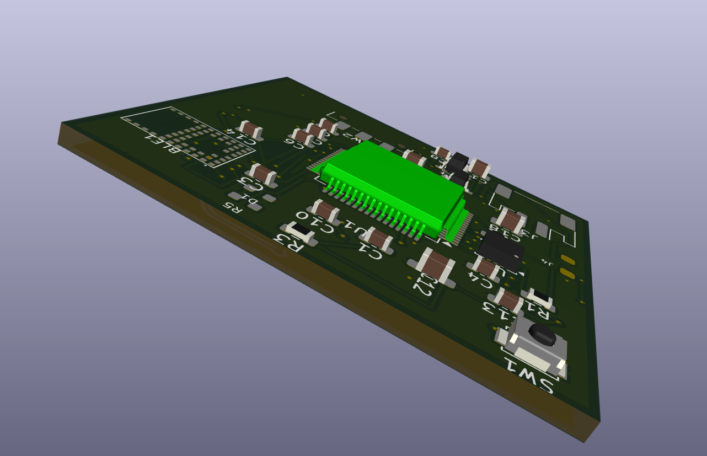
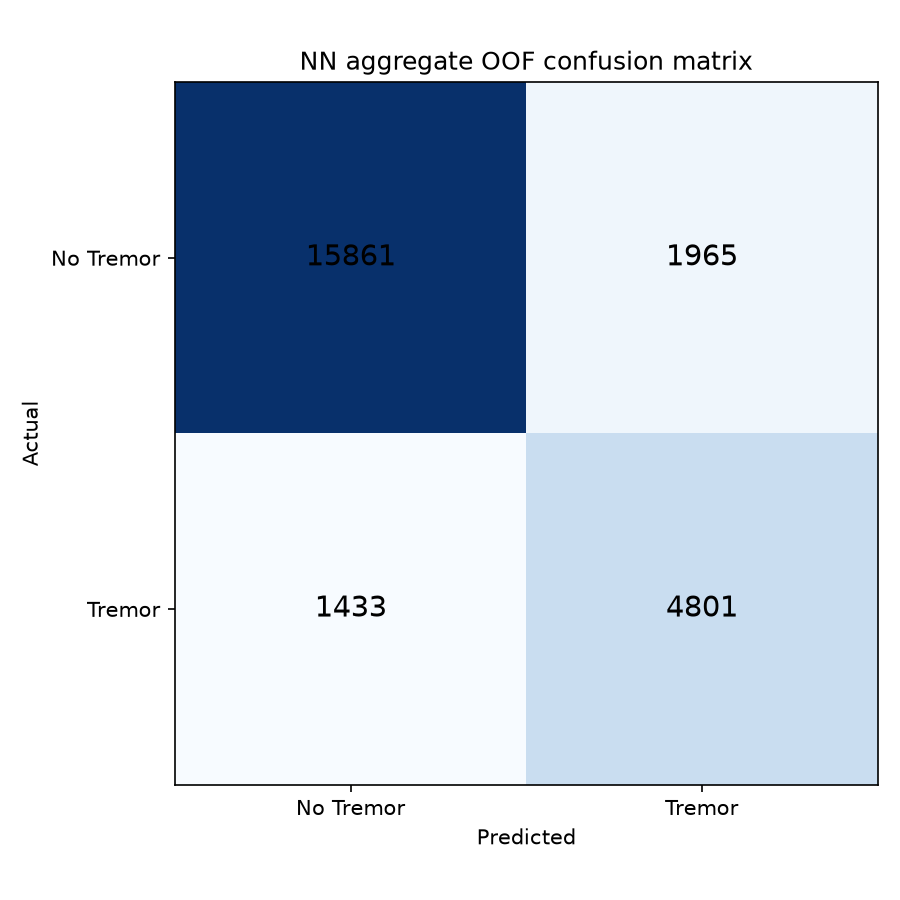
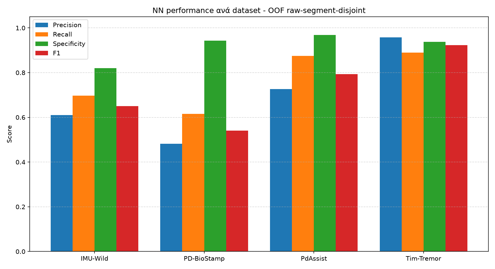

[← Portfolio index](../../README.md)

# Wearable Tremor Detection with Edge AI

**Python · TensorFlow/Keras · Signal Processing · Embedded Systems · KiCad**

An internship project by Petros Charalampidis at CERTH/ITI combining
accelerometer-based tremor classification, deployment-oriented firmware
and a four-layer wearable PCB design.

*CAD rendering of the designed board. The PCB was not manufactured.*

## Problem and approach

The aim is to distinguish tremor from no-tremor accelerometer windows and
prepare that processing pipeline for a low-power wearable. The work spans
data preparation, time/frequency-domain features, model evaluation,
embedded communication and hardware design.

The reported study uses 24,060 windows of 128 samples at 50 Hz, assembled
from TIM-Tremor, PdAssist, IMU-Wild and PD-BioStamp. The final deployment
feature selection contains 66 inputs.

## Selected implementation examples

The [code excerpts](CODE_EXCERPTS.md) show a compact neural-network
architecture and group-disjoint evaluation checks. The complete training
pipeline, firmware, CAD files, trained weights and datasets remain outside
this public portfolio.

## Reported offline results

| Metric | Reported value |
| --- | ---: |
| Accuracy | 85.9% |
| Precision | 71.0% |
| Recall | 77.0% |
| F1 | 73.9% |
| ROC-AUC | 93.6% |

These figures are supplied project results. The training script uses five
outer group-aware folds and an inner group-disjoint validation split.
Groups identify raw segments/recordings, not necessarily distinct patients.
Training was not repeated for this public presentation.

## Scope

The project demonstrates sensor processing, model evaluation and embedded
system design. Full end-to-end hardware validation remains pending because
the PCB was not manufactured. The reported offline results do not establish
clinical performance or measured on-device accuracy.

## Public contents

- Project overview and selected evaluation/CAD images.
- Two short implementation excerpts with source context.

The original report and complete deliverables are retained with the full project.
