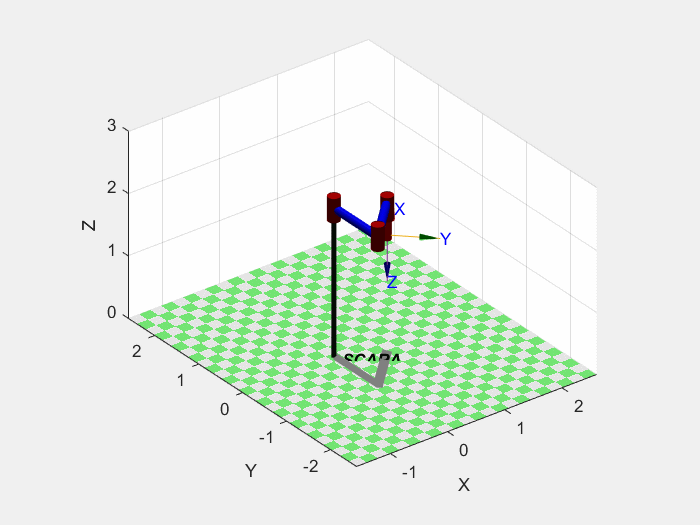

[← Portfolio index](../../README.md)

# SCARA Trajectory Planning and Adaptation

**MATLAB · Kinematics · Trajectory Generation · Dynamic Movement Primitives**

An academic robotics project by Petros Charalampidis simulating a SCARA
manipulator handling and assembling parts between conveyor positions.

*Recorded simulation output supplied with the project.*

## Problem statement

Plan and simulate a synchronized assembly cycle, then adapt the motion
when the target position and orientation change.

## Approach

- Describe intermediate tool poses using homogeneous transformations.
- Generate linear and cubic trajectory segments.
- Study tool and joint motion through kinematics and simulation.
- Train Dynamic Movement Primitives (DMPs) from nominal trajectories.
- Adapt position and orientation trajectories to perturbed targets.

The [code excerpts](CODE_EXCERPTS.md) illustrate the DMP forcing target,
Gaussian basis placement and trajectory-reproduction update.

## Results and scope

The project includes a nominal recorded simulation and comparative
position/orientation scenarios. Target-pose changes are simulated inputs;
a camera-based perception pipeline is a potential extension.

The available results concern simulation. Physical robot behavior and
performance were not evaluated in this public preparation.

## Public contents

The animation and two short DMP excerpts are included. The full simulator,
robot-model setup, trajectory helpers and report remain with the complete project.
