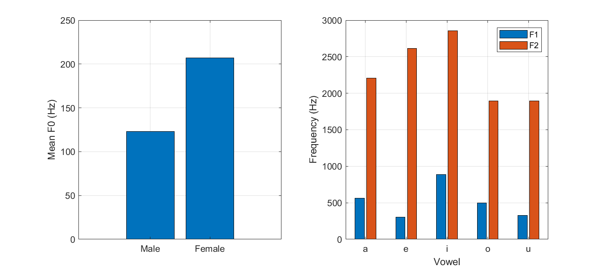

[← Portfolio index](../../README.md)

# Speech Analysis and Resynthesis in the Cepstral Domain

**MATLAB · Speech Processing · Cepstrum · Liftering · LPC**

An academic signal-processing project by Petros Charalampidis examining ten
recordings of spoken English letter names A, E, I, O and U from two voices.




## Problem Statement

Analyze male and female vowel recordings using cepstral techniques and homomorphic filtering. Compare voice characteristics, apply liftering to separate source and filter contributions, and reconstruct speech signals to assess the effects of different processing choices.

## Processing

- Mono conversion, DC removal and amplitude normalization.
- Voiced-frame selection and cepstral pitch estimation.
- Real/complex cepstrum and low/high-quefrency liftering.
- Source/filter separation and cepstral spectral-envelope analysis.
- Frame-based LPC resynthesis and a separate direct cepstral resynthesis.
- Optional HOSA bispectrum analysis.

## Included results

`results/` contains the supplied figures, a quantitative CSV and synthesized
WAV files. The original result descriptions are preserved in
`docs/original-results-readme.md`. Listen to the two synthesis variants to
compare the time-varying LPC model with the fixed-frame cepstral model.

## Running and missing inputs

The source expects an `audio/` folder containing:

- `male_a.m4a`, `male_e.m4a`, `male_i.m4a`, `male_o.m4a`, `male_u.m4a`
- `female_a.m4a`, `female_e.m4a`, `female_i.m4a`, `female_o.m4a`, `female_u.m4a`

**These original recordings are absent from the uploaded ZIP.** Synthesized
WAV outputs are not substitutes for the missing source recordings.

Restore the original recordings with the speakers' permission, install MATLAB
with the signal-processing functions used by the script, and run from the
project folder (`projects/07-speech-cepstral-analysis`):

```matlab
work4
```

HOSA's `bispecd` is optional in this script: the code warns and continues the
remaining analysis when it is unavailable. Missing source audio is a blocking
input error. Processing was not rerun during portfolio preparation.

See the [report](docs/report.pdf)
